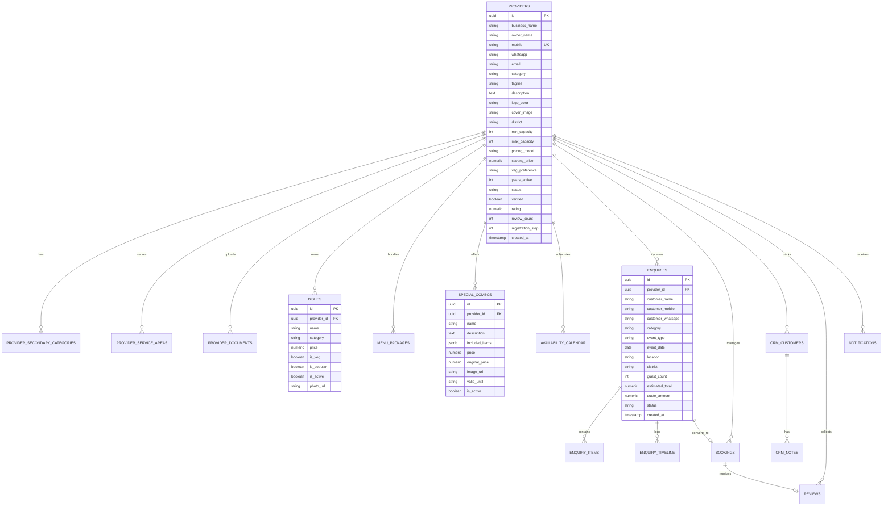

# Aagara Thirupthi Provider — Backend Specification & Database Architecture

## 1. System Architecture Overview

The **Aagara Thirupthi** platform connects event service providers (Catering, Decoration, Audio & Sound, Makeup Artists) with end customers and event planners.

```
┌─────────────────────────────────┐       ┌─────────────────────────────────┐
│   Provider App (React Native)   │       │     User App (Customer Web)     │
└────────────────┬────────────────┘       └────────────────┬────────────────┘
                 │                                         │
                 │              HTTPS / JSON               │
                 └───────────────────┬─────────────────────┘
                                     │
                        ┌────────────▼────────────┐
                        │   API Gateway / Reverse │
                        │      Proxy (Nginx)      │
                        └────────────┬────────────┘
                                     │
                        ┌────────────▼────────────┐
                        │  Backend REST Service   │
                        │ (Node.js / Go / Python) │
                        └──────┬────────────┬─────┘
                               │            │
            ┌──────────────────┴──┐      ┌──┴──────────────────┐
            ▼                     ▼      ▼                     ▼
┌───────────────────────┐   ┌───────────────┐   ┌───────────────────────────┐
│ PostgreSQL Relational │   │ Redis (Cache, │   │ S3 / Cloud Storage        │
│ Database (ACID Store) │   │ OTP & PubSub) │   │ (Documents, Photos & PDFs)│
└───────────────────────┘   └───────────────┘   └───────────────────────────┘
```

### Key Technical Guidelines
- **Protocol:** RESTful JSON over HTTPS, Bearer Token JWT authentication.
- **Database Engine:** PostgreSQL 15+ (supports native JSONB, UUIDs, array types, robust indexing).
- **File Storage:** AWS S3 / Cloudflare R2 / GCS with pre-signed upload URLs.
- **Real-Time / Notifications:** WebSockets or Firebase Cloud Messaging (FCM) / Expo Push Notifications.

---

## 2. Entity-Relationship (ER) Diagram



---

## 3. Database Table Structures (PostgreSQL DDL)

### 3.1. Providers Table (`providers`)
Stores primary provider profiles, registration state, and business info.

```sql
CREATE TYPE provider_status_enum AS ENUM (
    'draft', 'pending', 'under_review', 'approved', 'rejected', 'suspended'
);

CREATE TYPE service_category_enum AS ENUM (
    'catering', 'decoration', 'audio', 'makeup'
);

CREATE TYPE pricing_model_enum AS ENUM (
    'per_dish', 'per_person', 'package', 'custom'
);

CREATE TYPE veg_preference_enum AS ENUM (
    'veg', 'non_veg', 'both'
);

CREATE TABLE providers (
    id UUID PRIMARY KEY DEFAULT gen_random_uuid(),
    business_name VARCHAR(150) NOT NULL,
    owner_name VARCHAR(120) NOT NULL,
    mobile VARCHAR(15) NOT NULL UNIQUE,
    whatsapp VARCHAR(15) NOT NULL,
    email VARCHAR(120),
    category service_category_enum NOT NULL DEFAULT 'catering',
    tagline VARCHAR(255),
    description TEXT,
    logo_color VARCHAR(10) DEFAULT '#0E7C7B',
    cover_image VARCHAR(500),
    district VARCHAR(100) NOT NULL DEFAULT 'salem',
    min_capacity INT NOT NULL DEFAULT 50,
    max_capacity INT NOT NULL DEFAULT 500,
    pricing_model pricing_model_enum NOT NULL DEFAULT 'per_person',
    starting_price NUMERIC(10, 2) NOT NULL DEFAULT 0.00,
    veg_preference veg_preference_enum NOT NULL DEFAULT 'both',
    years_active INT NOT NULL DEFAULT 1,
    status provider_status_enum NOT NULL DEFAULT 'draft',
    verified BOOLEAN NOT NULL DEFAULT FALSE,
    rating NUMERIC(2, 1) NOT NULL DEFAULT 0.0,
    review_count INT NOT NULL DEFAULT 0,
    response_time VARCHAR(80) DEFAULT 'Usually responds within 2 hours',
    registration_step INT NOT NULL DEFAULT 0, -- 0 to 7 (7 = completed & submitted)
    is_active BOOLEAN NOT NULL DEFAULT TRUE,
    created_at TIMESTAMPTZ NOT NULL DEFAULT NOW(),
    updated_at TIMESTAMPTZ NOT NULL DEFAULT NOW()
);

CREATE INDEX idx_providers_category ON providers(category);
CREATE INDEX idx_providers_district ON providers(district);
CREATE INDEX idx_providers_status ON providers(status);
CREATE INDEX idx_providers_rating ON providers(rating DESC);
```

---

### 3.2. Provider Secondary Categories (`provider_secondary_categories`)
Stores additional services offered by a provider (e.g. Catering provider also offering Decoration or Makeup).

```sql
CREATE TABLE provider_secondary_categories (
    id UUID PRIMARY KEY DEFAULT gen_random_uuid(),
    provider_id UUID NOT NULL REFERENCES providers(id) ON DELETE CASCADE,
    category service_category_enum NOT NULL,
    created_at TIMESTAMPTZ NOT NULL DEFAULT NOW(),
    UNIQUE(provider_id, category)
);

CREATE INDEX idx_provider_secondary_cat ON provider_secondary_categories(provider_id);
```

---

### 3.3. Provider Service Coverage Areas (`provider_service_areas`)
Supports multi-district selection and "All Districts" coverage (P2).

```sql
CREATE TABLE provider_service_areas (
    id UUID PRIMARY KEY DEFAULT gen_random_uuid(),
    provider_id UUID NOT NULL REFERENCES providers(id) ON DELETE CASCADE,
    district VARCHAR(100) NOT NULL,
    areas JSONB NOT NULL DEFAULT '[]'::jsonb, -- Array of area names: ["Fairlands", "Hasthampatti"]
    travel_distance_km INT NOT NULL DEFAULT 25,
    is_all_districts BOOLEAN NOT NULL DEFAULT FALSE,
    created_at TIMESTAMPTZ NOT NULL DEFAULT NOW(),
    UNIQUE(provider_id, district)
);

CREATE INDEX idx_provider_areas_district ON provider_service_areas(district);
```

---

### 3.4. Provider Documents Table (`provider_documents`)
Supports optional FSSAI for catering, optional trade license, and business proofs (P3, P4).

```sql
CREATE TYPE document_status_enum AS ENUM (
    'missing', 'uploaded', 'verified', 'rejected'
);

CREATE TABLE provider_documents (
    id UUID PRIMARY KEY DEFAULT gen_random_uuid(),
    provider_id UUID NOT NULL REFERENCES providers(id) ON DELETE CASCADE,
    doc_type VARCHAR(50) NOT NULL, -- 'owner_id', 'address_proof', 'trade_license', 'fssai_cert', 'gst_cert'
    label VARCHAR(150) NOT NULL,
    file_url VARCHAR(500),
    file_name VARCHAR(150),
    is_required BOOLEAN NOT NULL DEFAULT FALSE,
    status document_status_enum NOT NULL DEFAULT 'missing',
    fssai_number VARCHAR(20),       -- Optional 14-digit FSSAI number (P3)
    fssai_expiry_date DATE,         -- Optional FSSAI expiry date (P3)
    rejection_reason TEXT,
    verified_at TIMESTAMPTZ,
    created_at TIMESTAMPTZ NOT NULL DEFAULT NOW(),
    updated_at TIMESTAMPTZ NOT NULL DEFAULT NOW(),
    UNIQUE(provider_id, doc_type)
);

CREATE INDEX idx_provider_docs_provider ON provider_documents(provider_id);
```

---

### 3.5. Dishes Table (`dishes`)
Menu catalog for catering providers (P5).

```sql
CREATE TABLE dishes (
    id UUID PRIMARY KEY DEFAULT gen_random_uuid(),
    provider_id UUID NOT NULL REFERENCES providers(id) ON DELETE CASCADE,
    name VARCHAR(150) NOT NULL,
    category VARCHAR(80) NOT NULL, -- 'Rice', 'Curries', 'Non-Veg', 'Sweets', 'Drinks', 'Starters', etc.
    price NUMERIC(10, 2) NOT NULL,
    is_veg BOOLEAN NOT NULL DEFAULT TRUE,
    is_popular BOOLEAN NOT NULL DEFAULT FALSE,
    is_active BOOLEAN NOT NULL DEFAULT TRUE,
    photo_url VARCHAR(500),         -- Dish image (P5)
    created_at TIMESTAMPTZ NOT NULL DEFAULT NOW(),
    updated_at TIMESTAMPTZ NOT NULL DEFAULT NOW()
);

CREATE INDEX idx_dishes_provider ON dishes(provider_id);
CREATE INDEX idx_dishes_category ON dishes(category);
CREATE INDEX idx_dishes_active ON dishes(is_active);
```

---

### 3.6. Menu Packages Table (`menu_packages`)
Bundled menus with per-head pricing.

```sql
CREATE TABLE menu_packages (
    id UUID PRIMARY KEY DEFAULT gen_random_uuid(),
    provider_id UUID NOT NULL REFERENCES providers(id) ON DELETE CASCADE,
    name VARCHAR(150) NOT NULL,
    price_per_person NUMERIC(10, 2) NOT NULL,
    min_guests INT NOT NULL DEFAULT 50,
    includes JSONB NOT NULL DEFAULT '[]'::jsonb, -- Array of dish names or dish UUIDs
    is_veg BOOLEAN NOT NULL DEFAULT TRUE,
    is_active BOOLEAN NOT NULL DEFAULT TRUE,
    created_at TIMESTAMPTZ NOT NULL DEFAULT NOW(),
    updated_at TIMESTAMPTZ NOT NULL DEFAULT NOW()
);

CREATE INDEX idx_packages_provider ON menu_packages(provider_id);
```

---

### 3.7. Special Combos Table (`special_combos`)
Promotional discount combos with validity and included items (P6).

```sql
CREATE TABLE special_combos (
    id UUID PRIMARY KEY DEFAULT gen_random_uuid(),
    provider_id UUID NOT NULL REFERENCES providers(id) ON DELETE CASCADE,
    name VARCHAR(180) NOT NULL,
    description TEXT,
    included_items JSONB NOT NULL DEFAULT '[]'::jsonb, -- Array of item strings
    price NUMERIC(10, 2) NOT NULL,
    original_price NUMERIC(10, 2),
    image_url VARCHAR(500),
    valid_until VARCHAR(80) NOT NULL, -- e.g. '31 Dec 2026' or ISO date
    is_active BOOLEAN NOT NULL DEFAULT TRUE,
    created_at TIMESTAMPTZ NOT NULL DEFAULT NOW(),
    updated_at TIMESTAMPTZ NOT NULL DEFAULT NOW()
);

CREATE INDEX idx_combos_provider ON special_combos(provider_id);
CREATE INDEX idx_combos_active ON special_combos(is_active);
```

---

### 3.8. Availability Calendar Table (`provider_availability`)
Month-view calendar dates marked as available, booked, or blocked (P7).

```sql
CREATE TYPE day_availability_status AS ENUM (
    'available', 'unavailable', 'partial', 'booked'
);

CREATE TABLE provider_availability (
    id UUID PRIMARY KEY DEFAULT gen_random_uuid(),
    provider_id UUID NOT NULL REFERENCES providers(id) ON DELETE CASCADE,
    date DATE NOT NULL,
    status day_availability_status NOT NULL DEFAULT 'available',
    note VARCHAR(255),
    created_at TIMESTAMPTZ NOT NULL DEFAULT NOW(),
    updated_at TIMESTAMPTZ NOT NULL DEFAULT NOW(),
    UNIQUE(provider_id, date)
);

CREATE INDEX idx_availability_date ON provider_availability(provider_id, date);
```

---

### 3.9. Enquiries Table (`enquiries`)
Customer enquiries and full lifecycle tracking (P8).

```sql
CREATE TYPE enquiry_status_enum AS ENUM (
    'new', 'reviewing', 'responded', 'confirmation_pending', 
    'confirmed', 'completed', 'cancelled', 'rejected'
);

CREATE TABLE enquiries (
    id UUID PRIMARY KEY DEFAULT gen_random_uuid(),
    provider_id UUID NOT NULL REFERENCES providers(id) ON DELETE CASCADE,
    customer_name VARCHAR(120) NOT NULL,
    customer_mobile VARCHAR(15) NOT NULL,
    customer_whatsapp VARCHAR(15) NOT NULL,
    avatar_color VARCHAR(10) DEFAULT '#0E7C7B',
    category service_category_enum NOT NULL,
    event_type VARCHAR(100) NOT NULL, -- 'Wedding', 'Reception', 'Birthday', etc.
    event_date DATE NOT NULL,
    location VARCHAR(200) NOT NULL,
    district VARCHAR(100) NOT NULL,
    guest_count INT NOT NULL DEFAULT 100,
    estimated_total NUMERIC(12, 2) NOT NULL DEFAULT 0.00,
    quote_amount NUMERIC(12, 2),
    quote_message TEXT,
    notes TEXT,
    status enquiry_status_enum NOT NULL DEFAULT 'new',
    is_new_lead BOOLEAN NOT NULL DEFAULT TRUE,
    created_at TIMESTAMPTZ NOT NULL DEFAULT NOW(),
    updated_at TIMESTAMPTZ NOT NULL DEFAULT NOW()
);

CREATE INDEX idx_enquiries_provider ON enquiries(provider_id);
CREATE INDEX idx_enquiries_status ON enquiries(status);
CREATE INDEX idx_enquiries_event_date ON enquiries(event_date);
```

---

### 3.10. Enquiry Items Table (`enquiry_items`)
Line items requested by customer in an enquiry.

```sql
CREATE TABLE enquiry_items (
    id UUID PRIMARY KEY DEFAULT gen_random_uuid(),
    enquiry_id UUID NOT NULL REFERENCES enquiries(id) ON DELETE CASCADE,
    dish_id UUID REFERENCES dishes(id) ON DELETE SET NULL,
    package_id UUID REFERENCES menu_packages(id) ON DELETE SET NULL,
    name VARCHAR(150) NOT NULL,
    price NUMERIC(10, 2) NOT NULL,
    qty INT NOT NULL DEFAULT 1,
    created_at TIMESTAMPTZ NOT NULL DEFAULT NOW()
);

CREATE INDEX idx_enquiry_items_enquiry ON enquiry_items(enquiry_id);
```

---

### 3.11. Enquiry Timeline Table (`enquiry_timeline`)
Tracks communication history and status transition logs.

```sql
CREATE TYPE author_type_enum AS ENUM ('provider', 'customer', 'system');

CREATE TABLE enquiry_timeline (
    id UUID PRIMARY KEY DEFAULT gen_random_uuid(),
    enquiry_id UUID NOT NULL REFERENCES enquiries(id) ON DELETE CASCADE,
    author author_type_enum NOT NULL,
    message TEXT NOT NULL,
    created_at TIMESTAMPTZ NOT NULL DEFAULT NOW()
);

CREATE INDEX idx_enquiry_timeline_enquiry ON enquiry_timeline(enquiry_id, created_at);
```

---

### 3.12. Bookings Table (`bookings`)
Confirmed engagements with booking dates and payment details.

```sql
CREATE TYPE booking_status_enum AS ENUM (
    'confirmed', 'in_progress', 'completed', 'cancelled'
);

CREATE TABLE bookings (
    id UUID PRIMARY KEY DEFAULT gen_random_uuid(),
    enquiry_id UUID UNIQUE REFERENCES enquiries(id) ON DELETE SET NULL,
    provider_id UUID NOT NULL REFERENCES providers(id) ON DELETE CASCADE,
    customer_name VARCHAR(120) NOT NULL,
    customer_mobile VARCHAR(15) NOT NULL,
    category service_category_enum NOT NULL,
    event_type VARCHAR(100) NOT NULL,
    event_date DATE NOT NULL,
    location VARCHAR(200) NOT NULL,
    guest_count INT NOT NULL,
    amount NUMERIC(12, 2) NOT NULL,
    status booking_status_enum NOT NULL DEFAULT 'confirmed',
    created_at TIMESTAMPTZ NOT NULL DEFAULT NOW(),
    updated_at TIMESTAMPTZ NOT NULL DEFAULT NOW()
);

CREATE INDEX idx_bookings_provider ON bookings(provider_id);
CREATE INDEX idx_bookings_status ON bookings(status);
CREATE INDEX idx_bookings_date ON bookings(event_date);
```

---

### 3.13. CRM Customers Table (`crm_customers`) & Notes (`crm_notes`)
Tracks lifetime customer relationship pipeline.

```sql
CREATE TYPE crm_stage_enum AS ENUM (
    'new_lead', 'contacted', 'quoted', 'booked', 'completed', 'lost'
);

CREATE TABLE crm_customers (
    id UUID PRIMARY KEY DEFAULT gen_random_uuid(),
    provider_id UUID NOT NULL REFERENCES providers(id) ON DELETE CASCADE,
    name VARCHAR(120) NOT NULL,
    mobile VARCHAR(15) NOT NULL,
    whatsapp VARCHAR(15) NOT NULL,
    avatar_color VARCHAR(10) DEFAULT '#0E7C7B',
    stage crm_stage_enum NOT NULL DEFAULT 'new_lead',
    total_enquiries INT NOT NULL DEFAULT 1,
    total_bookings INT NOT NULL DEFAULT 0,
    lifetime_value NUMERIC(12, 2) NOT NULL DEFAULT 0.00,
    last_contact_at TIMESTAMPTZ NOT NULL DEFAULT NOW(),
    tags JSONB NOT NULL DEFAULT '[]'::jsonb,
    created_at TIMESTAMPTZ NOT NULL DEFAULT NOW(),
    updated_at TIMESTAMPTZ NOT NULL DEFAULT NOW(),
    UNIQUE(provider_id, mobile)
);

CREATE TABLE crm_notes (
    id UUID PRIMARY KEY DEFAULT gen_random_uuid(),
    customer_id UUID NOT NULL REFERENCES crm_customers(id) ON DELETE CASCADE,
    message TEXT NOT NULL,
    created_at TIMESTAMPTZ NOT NULL DEFAULT NOW()
);

CREATE INDEX idx_crm_provider ON crm_customers(provider_id);
CREATE INDEX idx_crm_stage ON crm_customers(stage);
```

---

### 3.14. Reviews Table (`reviews`)
Customer feedback and rating breakdown.

```sql
CREATE TABLE reviews (
    id UUID PRIMARY KEY DEFAULT gen_random_uuid(),
    provider_id UUID NOT NULL REFERENCES providers(id) ON DELETE CASCADE,
    booking_id UUID REFERENCES bookings(id) ON DELETE SET NULL,
    customer_name VARCHAR(120) NOT NULL,
    avatar_color VARCHAR(10) DEFAULT '#0E7C7B',
    rating NUMERIC(2, 1) NOT NULL CHECK (rating >= 1.0 AND rating <= 5.0),
    event_type VARCHAR(100) NOT NULL,
    comment TEXT NOT NULL,
    quality_rating NUMERIC(2, 1) DEFAULT 5.0,
    communication_rating NUMERIC(2, 1) DEFAULT 5.0,
    value_rating NUMERIC(2, 1) DEFAULT 5.0,
    timeliness_rating NUMERIC(2, 1) DEFAULT 5.0,
    provider_reply TEXT,
    provider_reply_at TIMESTAMPTZ,
    created_at TIMESTAMPTZ NOT NULL DEFAULT NOW()
);

CREATE INDEX idx_reviews_provider ON reviews(provider_id);
```

---

### 3.15. Notifications Table (`notifications`)
In-app alerts for new leads, booking confirmations, and status updates.

```sql
CREATE TYPE notification_type_enum AS ENUM (
    'enquiry', 'booking', 'review', 'system', 'approval'
);

CREATE TABLE notifications (
    id UUID PRIMARY KEY DEFAULT gen_random_uuid(),
    provider_id UUID NOT NULL REFERENCES providers(id) ON DELETE CASCADE,
    title VARCHAR(150) NOT NULL,
    message TEXT NOT NULL,
    type notification_type_enum NOT NULL DEFAULT 'system',
    is_read BOOLEAN NOT NULL DEFAULT FALSE,
    reference_id UUID, -- enquiry_id or booking_id
    created_at TIMESTAMPTZ NOT NULL DEFAULT NOW()
);

CREATE INDEX idx_notifications_provider ON notifications(provider_id, is_read);
```

---

## 4. RESTful API Specification

All protected endpoints require the HTTP header:
```http
Authorization: Bearer <jwt_access_token>
Content-Type: application/json
```

Standard Response Format:
```json
{
  "success": true,
  "data": { ... },
  "message": "Operation successful"
}
```

Standard Error Format:
```json
{
  "success": false,
  "error": {
    "code": "VALIDATION_FAILED",
    "message": "Invalid input parameters",
    "details": [ ... ]
  }
}
```

---

### 4.1. Authentication APIs

#### 1. Send OTP
- **Endpoint:** `POST /api/v1/auth/send-otp`
- **Request Body:**
```json
{
  "mobile": "9876543210"
}
```
- **Response `(200 OK)`:**
```json
{
  "success": true,
  "message": "OTP sent successfully to +91 9876543210",
  "data": {
    "expiresIn": 300,
    "isExistingUser": true
  }
}
```

#### 2. Verify OTP & Authenticate
- **Endpoint:** `POST /api/v1/auth/verify-otp`
- **Request Body:**
```json
{
  "mobile": "9876543210",
  "otp": "123456"
}
```
- **Response `(200 OK)`:**
```json
{
  "success": true,
  "data": {
    "token": "eyJhbGciOiJIUzI1NiIsInR5c...",
    "refreshToken": "dGhpcy1pcy1yZWZyZXNo...",
    "provider": {
      "id": "c1f7b02e-6d12-4f32-849c-391f1b2b8901",
      "businessName": "Sree Annapoorna Catering",
      "mobile": "9876543210",
      "status": "approved",
      "registrationStep": 7
    }
  }
}
```

---

### 4.2. Registration & Profile Onboarding APIs

#### 1. Get Current Provider Profile / Resume Registration
- **Endpoint:** `GET /api/v1/provider/profile`
- **Response `(200 OK)`:**
```json
{
  "success": true,
  "data": {
    "id": "c1f7b02e-6d12-4f32-849c-391f1b2b8901",
    "businessName": "Sree Annapoorna Catering",
    "ownerName": "Karthik Subramaniam",
    "mobile": "9876543210",
    "whatsapp": "9876543210",
    "category": "catering",
    "secondaryCategories": ["decoration"],
    "tagline": "Authentic Tamil wedding catering",
    "district": "salem",
    "serviceAreas": [
      { "district": "salem", "areas": ["Fairlands", "Hasthampatti"], "travelDistanceKm": 25 }
    ],
    "minCapacity": 50,
    "maxCapacity": 1500,
    "pricingModel": "per_person",
    "startingPrice": 220,
    "vegPreference": "both",
    "status": "draft",
    "registrationStep": 4
  }
}
```

#### 2. Save Business Info (Step 1)
- **Endpoint:** `PUT /api/v1/provider/registration/step-1`
- **Request Body:**
```json
{
  "businessName": "Sri Meenakshi Makeup Studio",
  "ownerName": "Meenakshi Sundaram",
  "whatsapp": "9876543210",
  "tagline": "Celebrity & bridal makeup styling",
  "description": "Professional bridal styling with 8+ years experience."
}
```

#### 3. Save Category Selection (Step 2 - P1)
- **Endpoint:** `PUT /api/v1/provider/registration/step-2`
- **Request Body:**
```json
{
  "category": "makeup",
  "secondaryCategories": []
}
```

#### 4. Save Service Details (Step 3 - P1)
- **Endpoint:** `PUT /api/v1/provider/registration/step-3`
- **Request Body (For Catering):**
```json
{
  "vegPreference": "both",
  "minCapacity": 50,
  "maxCapacity": 1500,
  "yearsActive": 10
}
```
- **Request Body (For Makeup):**
```json
{
  "minCapacity": 1,
  "maxCapacity": 3,
  "yearsActive": 6,
  "servicesOffered": ["Bridal Makeup", "Saree Draping", "HD / Airbrush"],
  "travelType": "both",
  "trialAvailable": true
}
```

#### 5. Save Pricing Model (Step 4)
- **Endpoint:** `PUT /api/v1/provider/registration/step-4`
- **Request Body:**
```json
{
  "pricingModel": "per_person",
  "startingPrice": 250
}
```

#### 6. Save Coverage Area (Step 5 - P2)
- **Endpoint:** `PUT /api/v1/provider/registration/step-5`
- **Request Body:**
```json
{
  "districts": ["salem", "namakkal", "erode"],
  "isAllDistricts": false,
  "areas": ["Fairlands", "Suramangalam", "Tiruchengode", "Perundurai"],
  "travelDistanceKm": 50
}
```

#### 7. Upload Document (Step 6 - P3, P4)
- **Endpoint:** `POST /api/v1/provider/documents/upload`
- **Content-Type:** `multipart/form-data`
- **Form Fields:**
  - `docType`: `"fssai_cert"` | `"trade_license"` | `"owner_id"` | `"address_proof"` | `"gst_cert"`
  - `file`: `<PDF or JPG File>`
  - `fssaiNumber`: `"12423005000123"` (optional)
  - `fssaiExpiryDate`: `"2028-12-31"` (optional)

#### 8. Submit Registration for Approval (Step 7)
- **Endpoint:** `POST /api/v1/provider/registration/submit`
- **Response `(200 OK)`:**
```json
{
  "success": true,
  "message": "Registration submitted for review",
  "data": {
    "status": "under_review",
    "registrationStep": 7
  }
}
```

---

### 4.3. Services & Menu Management APIs

#### 1. List Dishes (P5)
- **Endpoint:** `GET /api/v1/provider/dishes?category=Rice&active=true`
- **Response `(200 OK)`:**
```json
{
  "success": true,
  "data": [
    {
      "id": "d-101",
      "name": "Seeraga Samba Mutton Biriyani",
      "category": "Rice",
      "price": 280,
      "isVeg": false,
      "isPopular": true,
      "isActive": true,
      "photoUrl": "https://images.unsplash.com/photo-1589302168068-964664d93dc0"
    }
  ]
}
```

#### 2. Create / Edit / Delete Dish (P5)
- **Create:** `POST /api/v1/provider/dishes`
- **Update:** `PUT /api/v1/provider/dishes/:id`
- **Delete:** `DELETE /api/v1/provider/dishes/:id`
- **Request Body (Create / Update):**
```json
{
  "name": "Elaneer Payasam",
  "category": "Sweets",
  "price": 65,
  "isVeg": true,
  "isPopular": true,
  "isActive": true,
  "photoUrl": "https://images.unsplash.com/photo-1551024709-8f23befc6f87"
}
```

#### 3. Special Combos APIs (P6)
- **List Combos:** `GET /api/v1/provider/combos`
- **Create Combo:** `POST /api/v1/provider/combos`
- **Update Combo:** `PUT /api/v1/provider/combos/:id`
- **Delete Combo:** `DELETE /api/v1/provider/combos/:id`
- **Request Body (Create / Update):**
```json
{
  "name": "Royal Wedding Feast Combo",
  "description": "Complete South Indian marriage banquet with 18 items + live dessert counter.",
  "includedItems": ["Ghee Biriyani", "Mutton Sukka", "Chicken 65", "Elaneer Payasam"],
  "price": 380,
  "originalPrice": 450,
  "imageUrl": "https://images.unsplash.com/photo-1555939594-58d7cb561ad1",
  "validUntil": "31 Dec 2026",
  "isActive": true
}
```

---

### 4.4. Availability Calendar APIs (P7)

#### 1. Get Month Availability
- **Endpoint:** `GET /api/v1/provider/availability?year=2026&month=10`
- **Response `(200 OK)`:**
```json
{
  "success": true,
  "data": {
    "year": 2026,
    "month": 10,
    "stats": { "available": 25, "booked": 4, "blocked": 2 },
    "days": [
      { "date": "2026-10-18", "status": "booked", "note": "Kalyanam at Salem" },
      { "date": "2026-10-25", "status": "unavailable", "note": "Personal Holiday" },
      { "date": "2026-10-26", "status": "available", "note": null }
    ]
  }
}
```

#### 2. Update Single Date Status
- **Endpoint:** `PUT /api/v1/provider/availability/date`
- **Request Body:**
```json
{
  "date": "2026-10-28",
  "status": "unavailable", // 'available' | 'booked' | 'unavailable'
  "note": "Blocked for maintenance"
}
```

---

### 4.5. Enquiries & Status Lifecycle APIs (P8)

#### 1. List Enquiries
- **Endpoint:** `GET /api/v1/provider/enquiries?status=new,reviewing`
- **Response `(200 OK)`:**
```json
{
  "success": true,
  "data": [
    {
      "id": "enq-001",
      "customerName": "Priya Ramesh",
      "customerMobile": "9842156789",
      "category": "catering",
      "eventType": "Wedding Reception",
      "eventDate": "2026-11-14",
      "guestCount": 400,
      "estimatedTotal": 140000,
      "status": "reviewing",
      "isNewLead": false
    }
  ]
}
```

#### 2. Update Enquiry Status (P8)
- **Endpoint:** `PATCH /api/v1/provider/enquiries/:id/status`
- **Request Body:**
```json
{
  "status": "confirmed", // 'reviewing' | 'responded' | 'confirmation_pending' | 'confirmed' | 'completed' | 'cancelled' | 'rejected'
  "reason": "Customer agreed on quote" // optional
}
```
- **Response `(200 OK)`:**
```json
{
  "success": true,
  "message": "Enquiry status updated to confirmed",
  "data": {
    "enquiryId": "enq-001",
    "newStatus": "confirmed",
    "bookingId": "bk-501"
  }
}
```

#### 3. Send Quote to Customer
- **Endpoint:** `POST /api/v1/provider/enquiries/:id/quote`
- **Request Body:**
```json
{
  "quoteAmount": 135000,
  "message": "Special festive pricing with complimentary welcome drink station."
}
```

#### 4. Add Communication Message
- **Endpoint:** `POST /api/v1/provider/enquiries/:id/messages`
- **Request Body:**
```json
{
  "message": "Called customer to finalize hall decoration colors."
}
```

---

### 4.6. Bookings, CRM & Notifications APIs

#### 1. List Bookings
- **Endpoint:** `GET /api/v1/provider/bookings?status=confirmed`

#### 2. Get CRM Customers Pipeline
- **Endpoint:** `GET /api/v1/provider/crm/customers?stage=quoted`

#### 3. Add Note to CRM Customer
- **Endpoint:** `POST /api/v1/provider/crm/customers/:id/notes`
- **Request Body:**
```json
{
  "message": "Follow up next Tuesday after family meeting."
}
```

#### 4. List Notifications & Mark Read
- **Get Notifications:** `GET /api/v1/provider/notifications`
- **Mark All Read:** `PATCH /api/v1/provider/notifications/read-all`

---

## 5. Security, Media Uploads & Production Checklist

1. **Authentication:**
   - Stateless JWT tokens (15-minute access token expiry, 30-day rotating refresh tokens stored in Redis).
2. **Passwordless OTP:**
   - Hash OTPs in Redis with 5-minute TTL.
   - Rate limit: max 3 OTP requests per phone number per 15 minutes.
3. **Document & Media Storage:**
   - Use Pre-Signed S3 upload URLs (`POST /api/v1/storage/presigned-url`).
   - Restrict uploads to `application/pdf`, `image/jpeg`, and `image/png` up to 10MB.
4. **Data Isolation & Multi-Tenancy:**
   - All queries on `dishes`, `combos`, `enquiries`, `bookings`, `crm_customers` must enforce `WHERE provider_id = :authenticated_provider_id`.
5. **Database Migration Strategy:**
   - Use standard migration tools (Prisma, TypeORM, Knex, or Flyway) implementing the DDL defined in Section 3.
